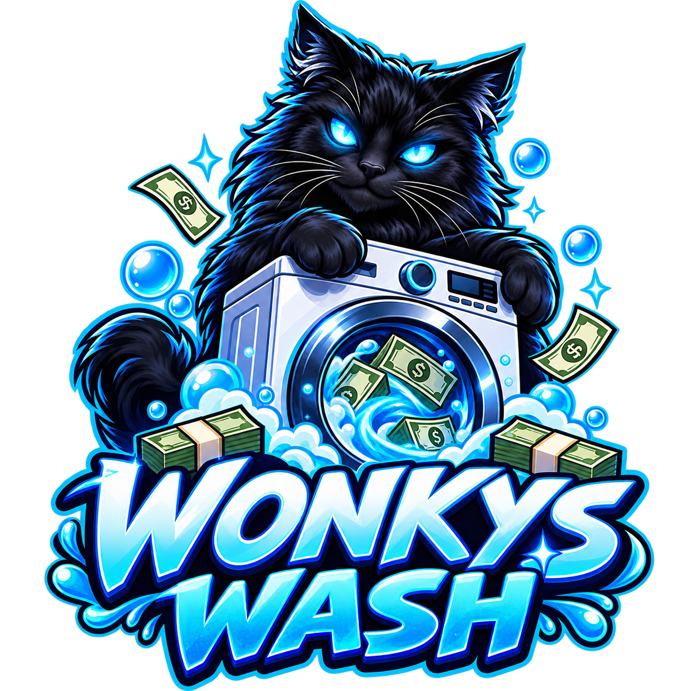
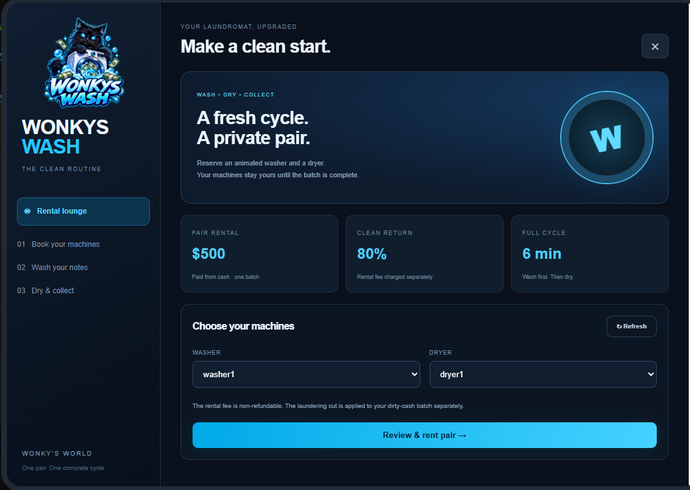

<p align="center"></p>

# Wonkys Wash

A two-stage money-washing resource for **FiveM Qbox**. Rent a washer and dryer from a branded tablet, load dirty cash into an animated Bzzz washer, collect wet notes, then dry them before receiving clean cash.

**Version 1.4.0 · Beta · Code: MIT**



## Features

- NPC attendant gives players a usable ox_inventory tablet.
- Neon-blue rental UI with Wonkys Wash branding, fee confirmation and assigned-machine status.
- One private washer/dryer pair per character, reserved for one complete batch.
- Bzzz animated washer shows money tumbling during the wash cycle.
- Full/empty Bzzz bag props with pickup, pouring and collection interactions.
- Dirty cash → timed wash → wet-money bundle → timed drying → Qbox clean cash.
- Saved placements, ownership, rentals and wall-clock cycle timers across reconnects/resource restarts.
- Server-side amount, inventory, rental, distance and timer checks; locks, request limits and financial journals.
- No map blips. Original MLO washer targets are disabled; only placed Bzzz washers and configured dryers are usable.

## Required downloads

**Third-party resources are not included in this repository. Install them separately.**

| Dependency | Download / documentation |
| --- | --- |
| Qbox core | [qbx_core](https://github.com/Qbox-project/qbx_core) |
| ox_lib | [Documentation](https://overextended.dev/ox_lib) |
| ox_target | [Documentation](https://overextended.dev/ox_target) |
| ox_inventory | [Documentation](https://overextended.dev/ox_inventory) |
| oxmysql | [Documentation](https://overextended.dev/oxmysql) |
| Bzzz Money props and animations | [Mrs. BzZz — Money](https://bzzz.tebex.io/package/7390529) |
| Abandoned Laundromat MLO | [gtaDPS — Abandoned Laundromat](https://www.gta5-mods.com/maps/abandoned-laundromat-interior-singleplayer-fivem-gtadps) |

Use the FiveM version of the MLO, not its single-player installation. OneSync is required. The supplied dryer positions match this laundromat. Other locations need configuration and placement adjustments. This resource targets Qbox; ESX/QBCore adapters are not included. Install dependencies from their maintained sources and test your particular versions together.

## Installation

1. Download/extract this repository. Rename the resource folder to **`Wonkys_MoneyWash`**. `fxmanifest.lua` must be directly inside it, not in an additional nested folder.
2. Install Bzzz's pack as **`bzzz_money`** and the MLO as **`laundry`**. Do not load duplicate copies of their streamed assets or YTYPs.
3. Import [`install/schema.sql`](install/schema.sql) with HeidiSQL or your database tool. The CREATE IF NOT EXISTS statements preserve existing tables. On upgrades, additional prop/rental/settings tables are also created automatically if the database user has CREATE permission.
4. Merge the entries in [`install/items.lua`](install/items.lua) **inside** the return table in `ox_inventory/data/items.lua`. Add `black_money` only if absent; do not overwrite the entire item file or duplicate existing items.
5. Copy `install/images/ww_wash_tablet.png` to `ox_inventory/web/images/ww_wash_tablet.png`.
6. Keep your existing working framework dependency order. Start `laundry` and `bzzz_money` before this resource. See [`install/server.cfg.example`](install/server.cfg.example).
7. Restart the server after adding inventory items/streamed assets. Bzzz warns that restarting streamed props while spawned can crash clients; do not hot-restart its resource while in use.
8. Place at least one Bzzz washer and the attendant as described below. A fresh install intentionally has no guessed Bzzz/NPC positions.

### First-time placement

In the **SERVER / txAdmin console**:

```text
washbzzzallow YOUR_SERVER_ID
```

If exactly one player is connected, `washbzzzallow` without an ID grants that character placement for the session. Alternatively configure the permanent ACE in the example server.cfg for your admin group.

In **in-game chat**:

```text
/washbzzz washer1
/washdesk
```

For `/washbzzz`, stand close and aim your camera at a **clear floor spot** where the Bzzz machine's base should be. An optional angle controls orientation: `/washbzzz washer1 90`. Place more IDs `washer2`–`washer4` if needed. It is a complete prop: do not overlap it with the original MLO washer geometry.

For `/washdesk`, stand where the attendant should stand and face the direction they should face. Step away after placing. Both placements persist in SQL. Configured dryer targets are already included. Active/rented machines cannot be moved.

F8 commands use **no slash**. If a command is missing, run `washbuild` in server console and `washcheck` in F8; see [troubleshooting](docs/ADMIN_GUIDE.md).

## Player flow

1. Target the attendant to receive/open your Wonkys Wash tablet.
2. Choose an available washer and dryer, review the fee, then confirm payment.
3. Target your assigned Bzzz washer and load a dirty-cash amount.
4. After washing finishes, collect the character-bound wet-money bundle.
5. Load that bundle into your assigned dryer.
6. After drying, collect clean cash; the pair is then released.

The tablet can be reopened from inventory. Holding it authorises remote rental/status access; physical machine actions always require proximity. An unused rental can be ended without refund. Once a batch starts, finish it. Disconnecting does not cancel or refund a batch. There is no automatic reservation expiry that discards player funds.

## Defaults and currency compatibility

| Setting | Default |
| --- | --- |
| Rental fee | $500 cash, once per complete batch |
| Laundering return | 80% of dirty input |
| Batch limits | $1,000–$50,000 |
| Washing / drying | 180 seconds / 180 seconds |
| Loading / unloading | 8 seconds / 6 seconds, cancellable |
| Dirty input | Count-based `black_money`: 1 item = $1 |
| Wet bundle / tablet | `ww_wet_cash` / `ww_wash_tablet` |

The rental fee is **additional** to the laundering cut. A $10,000 dirty batch returns $8,000 after drying, plus a separate $500 clean-cash rental payment. Change settings in `config.lua`. Existing batch payouts are fixed at wash start.

**Metadata-worth `markedbills` is not supported by simply renaming DirtyItem.** That needs a worth-aware currency adapter. The money bags are visual props; no separate bag inventory item is required. Temporary bag props are local; nearby players may see the ped animation without its bag. Bag/hand alignment needs testing with your ped models. Washer animation is provided by Bzzz's running model.

## Upgrading

Back up your database and config. Replace the whole resource folder, retain its exact name, reapply intentional config changes and merge newly required items. Keep the existing MLO/Bzzz resources and SQL data. Placements are stored in SQL, not this source ZIP. Old unplaced MLO washer targets stay disabled. See the [administrator guide](docs/ADMIN_GUIDE.md) for legacy batches, placement, diagnostics and reconciliation.

## Security and limitations

See [SECURITY.md](SECURITY.md). Server validation, locks and database uniqueness protect normal operations, but **Qbox cash, ox_inventory and SQL cannot be committed as a single atomic transaction**. Interrupted transfers can leave pending/claiming/loading records blocked for staff review. Never blindly refund or reset these states. Inventory persistence during a full server crash depends on the framework/inventory save behaviour. This is not an exploit-proof guarantee.

## Tests and beta status

Run on Lua 5.4 and Node.js:

```text
python3 tests/check_sources.py
lua5.4 tests/server_mock.lua
lua5.4 tests/client_target_mock.lua
lua5.4 tests/bzzz_visual_mock.lua
lua5.4 tests/rentals_mock.lua
lua5.4 tests/bag_mock.lua
node --check web/app.js
node tests/ui.test.cjs
```

On Windows, use `lua` if that is your Lua 5.4 executable name. `check_sources.py` detects `luac5.4` or `luac`. GitHub Actions runs these checks automatically. Injected model/payment failure messages during the tests are deliberate; assertions verify cleanup/journal behaviour.

Mocks check code paths without FiveM. They do not validate live networking, rendered UI, animated prop alignment or real database/inventory persistence. The washer animation and tablet UI have been seen working in the development server; the latest bag interactions and multiplayer rental scenarios still need live acceptance testing. Use the [live checklist](docs/TESTING.md) before public production deployment.

## Credits and licence

- Script, UI and project branding: **Wonkys World**.
- Money props, washer models and custom animations: **Mrs. BzZz** — [official pack](https://bzzz.tebex.io/package/7390529).
- Abandoned Laundromat interior: **gtaDPS** — [official download](https://www.gta5-mods.com/maps/abandoned-laundromat-interior-singleplayer-fivem-gtadps).
- Qbox and the Ox ecosystem authors/contributors for the dependencies.

Original code in this repository is provided under the [MIT licence](LICENSE). Branding/artwork is covered separately by [ASSETS.md](ASSETS.md). Third-party props, maps and animations retain their creators' terms and are not redistributed here. This repository is not affiliated with the dependency authors.
